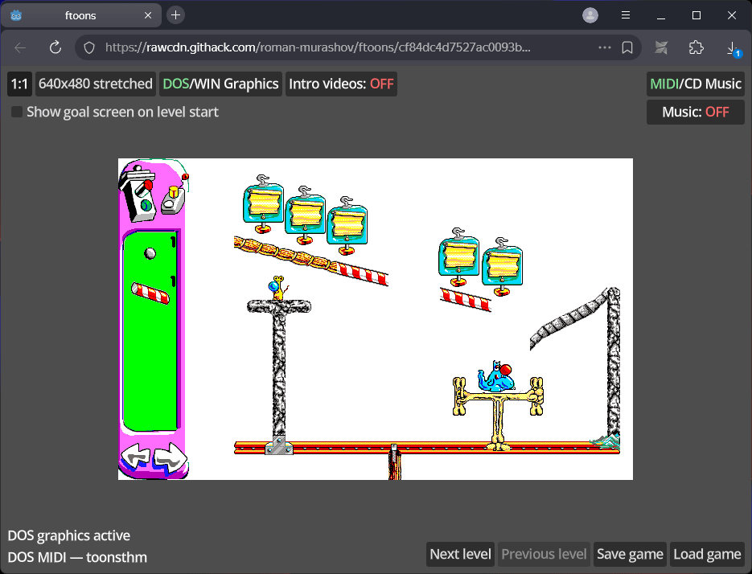
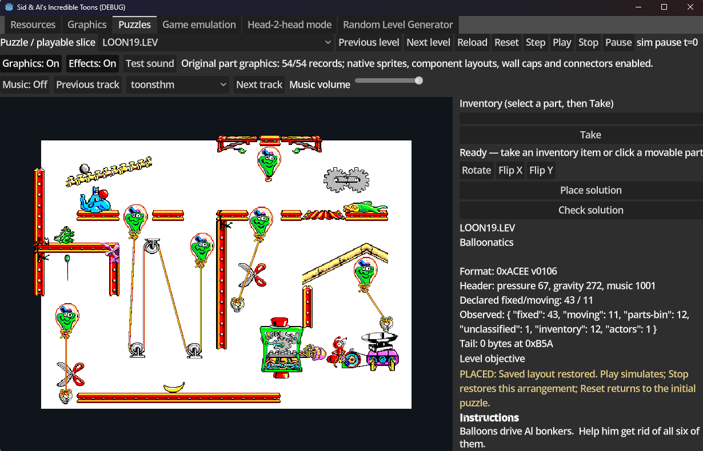
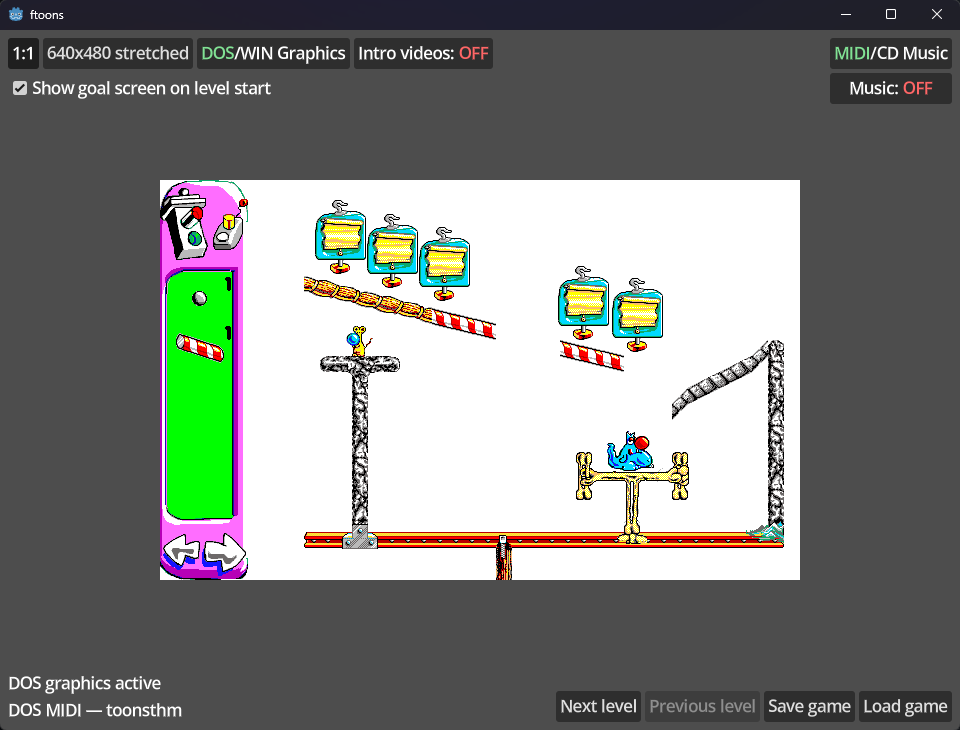
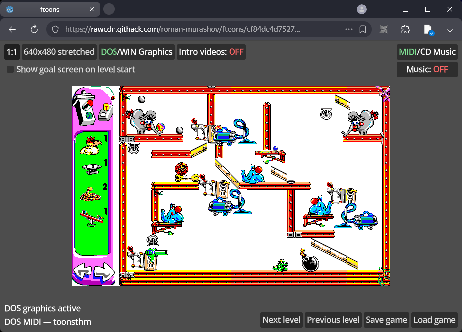

# ftoons
A free implementation of The Incredible Toon Machine

# Q: What is ftoons?

**ftoons** is a recreation of *Sid and Al's Incredible Toons* (DOS) and *The Incredible Toon Machine* (Windows) games.

This is an open-source project designed to port original gameplay to Godot game engine. The purposes of the project are:

- to eliminate the need of Dosbox
- to provide easy access to the game on modern platforms: PC and Web
- to allow community to create and share custom levels in `JSON` format along with original `*.LEV` ones

## Q: What are the differences from the original gameplay?

The gameplay is identical. All collisions and physics interactions work as intended by creators.

## Q: What was added to the port?

You are able to switch between DOS/Windows graphics and music if you import both DOS and Windows versions of the game.

<p align="center">
    
</p>

You can export levels to `JSON`.

> **TODO:** Web version allows to provide URL to Github repos with your custom levels, so feel free to create level packs and share among friends.

**Random Level Generator** tries to give you as much fun as possible: generate a level with description and be as human-like as possible.

## Q: What are current branches?

1. **Debug build Windows** is a branch of my current development build. This includes several tabs in-game such as Resources, Graphics, Puzzles, Game Emulation, Head-2-head mode and Random Level generator. Puzzles tab was the main project scope: from here you can **"Place solution"** on a level and test how it works. "Game emulation" tab reflects the events in "Puzzles" tab.

<p align="center">
    
</p>

3. **Windows build.** This is a regular build for users. Launch it, import resources and play the original game on your Windows PC. If you provide correct ISO, you will enjoy CD music here. Use the editor to make custom levels and save them.

<p align="center">
    
</p>

4. **Web build.** This is a web-ready build that can be accessed by github link. Currently level loading by URL is not implemented. You have to provide DOS files once (choose ADL.DRV, TOONS.EXE and RESOUCE.001 manually or supply ZIP). [Play here!](https://rawcdn.githack.com/roman-murashov/ftoons/cf84dc4d7527ac0093b61781e3d97c8663dab0c8/ftoons_web/index.html)

<p align="center">
    
</p>

## Q: How did you create this project?

I played the game in 1996 and fell in love with it. I always wondered how the game works from within, but my skills in reverse engineering were too low to inspect the bineries.

With help of LLMs in 2026 i was able to build several tools that connect DOS execution with Godot scenes and inspect live object properties. After a lot of testing and manual corrections i was able to create a playable build that is almost identical to original 100-level campaign and offers smooth gameplay experience to modern players.

## Q: What next?

I wanted to see how people will express themselves in building Goldberg machines ingame, because original Toons were released in pre-internet era. This project is a method to popularize the game. Possibly i will add custom-sized levels to see how big the machines could really be!

## Q: Do you make money from it?

Absolutely not. Original game rights belong to the creators and IP holders. I am not accepting donations in any form. For using this project you have to own a legal game copy.

## Q: How to launch the project?

If you downloaded Debug Windows files:

1. Download **Godot 4.7** and import project (<kbd>Ctrl+I</kbd>).
2. In Godot Run project (<kbd>F5</kbd>).
3. Project will ask you to import game files. Provide mandatory DOS files for minimal gameplay. If you provide Windows version ISO you'll have additional 50 puzzles in **"Home Toons"**.

If you downloaded Windows Production files of Web version:

1. Unpack ZIP.
2. Launch ftoons.exe (index.html for web version)
3. Provide game files.

### Mandatory DOS files (`Sid__Als_Incredible_Toons_1993.zip`):

<details>
<summary>1. ADL.DRV</summary>

```text
Name: ADL.DRV
Size: 9295 bytes (9 KiB)
CRC32: 2596AA71
CRC64: 20228D7003A0F224
SHA256: f1d093291b4395e485e9d19cb6684ffecf3c5dab31f2462264bf6fd4f15907af
SHA1: 01af3ec72b8b94ccc088d61538d75046d5f6c19e
BLAKE2sp: c861a4971606d787e82a1c61d5ab6a4932d013056e7662dcd48c29e5c7b25655
```

</details>


<details>
<summary>2. TOONS.EXE</summary>

```text
Name: TOONS.EXE
Size: 471936 bytes (460 KiB)
CRC32: 028843B5
CRC64: 8467C37F0C61FC41
SHA256: cc37575f7bf1f36ac1b2083f82095930fc2d132881f9b619de46452210c30fc1
SHA1: e26e1f2ae6bc888084acf53d72ae00f120841d6b
BLAKE2sp: 9bbbef73311d294ed0b216ddae915d4dc1dcd4ead9bfc207a8cf009ccd50d528
```

</details>

<details>
<summary>3. RESOURCE.001</summary>

```text
Name: RESOURCE.001
Size: 2829557 bytes (2763 KiB)
CRC32: EA24A12B
CRC64: 45B0DBABE08BB68D
SHA256: 30bb21ea0cd1fc87ceb83dc804639f86cf115e815e1de301d561d2ec3be4b87e
SHA1: 477f686aad6d400f95b607031b9ece51d78c2c0a
BLAKE2sp: 72ad63130a07aa9ba7bba3049f9419bbfa9703f3054386e140ec5336fa8658fb
```

</details>

### Optional Windows ISO with Intro videos and CD Music:

<details>
<summary>1. BIN (choose it while importing)</summary>

```text
Name: The Incredible Toon Machine.bin
Size: 597589104 bytes (569 MiB)
CRC32: A468D861
CRC64: 6ABC3913DBBEA50C
SHA256: 547609858f3123badabffae99fc826d08fab935da9c79f3f58eb689db3d06634
SHA1: cf9cc8256246f520678a7de2e82b2f0172bb6971
BLAKE2sp: 1049f1679632540e27fae6ee730464763138f1189e7a9bdad8dbd96889e05ad6
```

</details>

<details>
<summary>2. CUE</summary>

```text
Name: The Incredible Toon Machine.cue
Size: 1046 bytes (1 KiB)
CRC32: 0D9061FB
CRC64: F05910801DFB47FC
SHA256: b3f299fe222e866050877cd39fdcadea032b96a9b48f3498e3dd13091b2a38f1
SHA1: 42302ab18db0a38e50d6fe4136eb0a9c27e1de56
BLAKE2sp: 78c88a111592e686e9e03247df12373482dcd2d9cae86c8d96529446c83c2595
```

</details>

### Optional Windows ISO with Intro videos and without CD Music (`MASQUE.iso`):

<details>
<summary>1. ISO</summary>

```text
Имя: MASQUE.iso
Размер: 38895616 байтов (37 MiB)
CRC32: 8D4A28A8
CRC64: 598D26751ACBE523
SHA256: b06187bb223fbb15f9484496b06556f99912094059d5a6df444a68549023283c
SHA1: 89b3a704869ca791290de8416c8bb8e7fdbeda03
BLAKE2sp: 8945dcccd38f516b86496aa8a0c478e86a486cebe27175bdc455b3bb711971f0
```

</details>


## Development history (generated report)

The project started on **October 12, 2026**,  we chose Godot and GDScript for the port. The first locally tested browser build followed on **November 21**, 40 days after the project began.

### Development by the numbers

| Metric | As of November 25, 2026 |
|---|---:|
| Development chats | 5 |
| Messages sent by the developer | 563 |
| Recorded Codex working time | 152 hours 35 minutes |
| Total recorded token usage | Approximately 4.04 billion |

Working time counts the elapsed time of Codex development turns, including tool runs and waits. Overlapping turns count once. Token usage includes cached input and breaks down to **3.14 billion** tokens in the development chats, **848 million** in subagents, and **48 million** in automated reviews. The figures exclude the separate chats used to prepare project statistics and README copy.

### Tools built for the port (not included to repository)

| Tool | How we used it |
|---|---|
| Live DOS Monitor | Read object records directly from a running DOSBox-X process and logged changes as a puzzle played. This let us follow characters and gadgets without interrupting the simulation. |
| Live Capture Controller | Sent debugger commands, set breakpoints, and captured registers and named memory regions. Saved snapshots let us revisit the same puzzle state while investigating a discrepancy. |
| DOS–Godot Comparison Runner | Ran the same puzzle setup in DOS and Godot and compared state after each simulation update. It identified the first divergence in object behavior, sound requests, or goal completion. |
| Windows–Godot comparison tools | Checked the port’s Head-to-head puzzle rules against goal logic recovered from the Windows MPC edition. Validation included **60,000 native goal comparisons** and **700 selected cases** checked again in GDScript. |

### Models used

**GPT-6.1 Sol, GPT-6 Luna, and GPT-6 Astra** accounted for the largest shares of token usage in the November 21 records with per-response model data. Across the available logs through November 25, the following model identifiers appear:

| Family | Recorded variants |
|---|---|
| GPT-6.2 | Astra, Sol |
| GPT-6.1 | Sol, Terra |
| GPT-6 | Astra, Luna, Sol |
| GPT-5.6 | Luna, Sol, Terra |
